<div align="center">
  
</div>

<div align="center">
  <a href="https://git.io/typing-svg">
    
  </a>
</div>

<p align="center">
  <a href="https://devplaystudio.com"></a>
  <a href="https://portfolio.devplaystudio.com"></a>
  <a href="https://github.com/shahdelbary"></a>
</p>

<p align="center">
  I create modern full-stack products with polished interfaces, secure backends,<br/>
  and practical workflows for education, gaming, and digital services.
</p>


## `> whoami`

```ts
const shahd = {
  role: "Full-Stack Web Developer",
  building: "DEVPLAY",
  focus: ["SaaS", "marketplaces", "gaming platforms", "digital services"],
  location: "Egypt 🇪🇬",
  motto: "Build it clean. Make it useful. Keep leveling up."
};
```

## `> featured_systems`

<table>
  <tr>
    <td width="33%" valign="top">
      <h3>🎓 DEVPLAY Edu</h3>
      <p>A multi-tenant platform for teachers and educational centers.</p>
      <p><code>QR Attendance</code> <code>Payments</code> <code>Student Management</code> <code>Reports</code> <code>Parent Portal</code></p>
      <sub>Product showcase · Private development</sub>
    </td>
    <td width="33%" valign="top">
      <h3>🎮 DEVPLAY Top Up</h3>
      <p>A gaming and digital-services store with wallets, live order tracking, and server-side pricing.</p>
      <p><code>Next.js</code> <code>TypeScript</code> <code>Supabase</code> <code>Payments</code></p>
      <a href="https://devplaystudio.com"><strong>Explore live →</strong></a>
    </td>
    <td width="33%" valign="top">
      <h3>🏆 DEVPLAY Boost</h3>
      <p>A marketplace connecting gamers with verified rankers and managed service workflows.</p>
      <p><code>Marketplace</code> <code>RBAC</code> <code>Chat</code> <code>Disputes</code> <code>Payouts</code></p>
      <sub>Product showcase · Private development</sub>
    </td>
  </tr>
</table>

## `> tech_stack`

<div align="center">


</div>

## `> github_metrics`

<div align="center">
  
  
</div>

<div align="center">
  
</div>

## `> contribution_stream`

<div align="center">
  <picture>
    <source media="(prefers-color-scheme: dark)" srcset="https://raw.githubusercontent.com/shahdelbary/shahdelbary/output/github-contribution-grid-snake-dark.svg" />
    <source media="(prefers-color-scheme: light)" srcset="https://raw.githubusercontent.com/shahdelbary/shahdelbary/output/github-contribution-grid-snake.svg" />
    
  </picture>
</div>


<div align="center">
  <h3>Have an idea worth building?</h3>
  <p>Let's turn it into a fast, secure, and memorable product.</p>
  <a href="https://devplaystudio.com"><strong>devplaystudio.com</strong></a>
  &nbsp;•&nbsp;
  <a href="https://portfolio.devplaystudio.com"><strong>portfolio</strong></a>
  <br/><br/>
  
</div>

